# Figure Index

All 27 figures extracted from the source DOCX are preserved in `assets/images/`. Use these figures when explaining examples, checking whether a structure type is supported, or comparing generated E-SMILES strings against the source examples.

## Supported Examples

### Figure 1: Ordinary Molecule

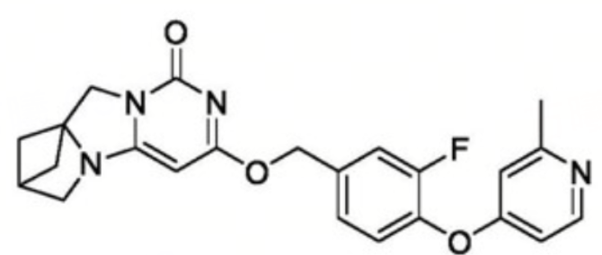

Source section: `二、样例 / （一）普通分子`.

Key point: ordinary molecules use RDKit-compatible SMILES followed by `<sep>` and no extension records.

### Figure 2: Markush Substituent

Source section: `二、样例 / （二）Markush分子`.

Key point: use `<a>0:R[1]</a>` for an atom-indexed Markush group.

### Figure 3: Connection Point

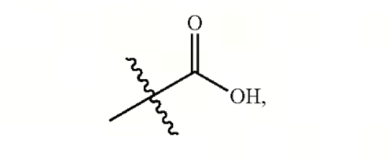

Source section: `二、样例 / （三）连接点`.

Key point: use `<d>0:<dum></d>` for a dummy connection point.

### Figure 4: Special Markush Group

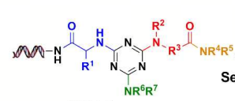

Source section: `二、样例 / （四）特殊Markush基团`.

Key point: inline special identifiers such as `<id>[DNA]` can appear as group values.

### Figure 5: Ring Attachment with Repeat Range

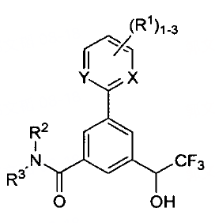

Source sections: `二、样例 / （五）环上连接集团 / 示例1` and `（六）重复基团 / 示例2`.

Key point: use `<r>1:R[1]?1-3</r>` for a variable number of ring-attached groups.

### Figure 6: Two Ring-Attached Groups

Source section: `二、样例 / （五）环上连接集团 / 示例2`.

Key point: multiple ring-attached groups on the same ring use multiple `<r>` records.

### Figure 7: Complex Ring-Attached Groups

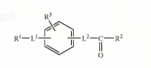

Source section: `二、样例 / （五）环上连接集团 / 示例3`.

Key point: complex ring substituents may be represented as nested `<s>...</s>` substructures or as compact aliases.

### Figure 8: Simple Repeat n

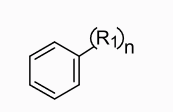

Source section: `二、样例 / （六）重复基团 / 示例1`.

Key point: append `?n` to the repeated group name, for example `R[1]?n`.

### Figure 9: Repeated Substructure

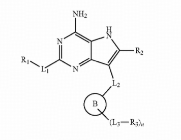

Source section: `二、样例 / （六）重复基团 / 示例3`.

Key point: simple repeated substructures can be compacted as aliases, while complex cases should use complex repeat notation.

### Figure 10: Polymer Original Structure

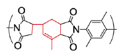

Source section: `二、样例 / （七）高分子/聚合物 / 示例1`.

Key point: first identify the repeating unit and endpoints before adding `|Sg:n|`.

### Figure 11: Polymer Repeat Unit

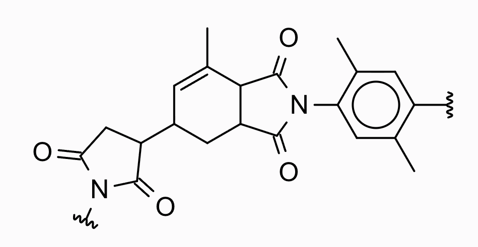

Source section: `二、样例 / （七）高分子/聚合物 / 示例1`.

Key point: repeat endpoints are represented as dummy connection points.

### Figure 12: Basic Abstract Ring

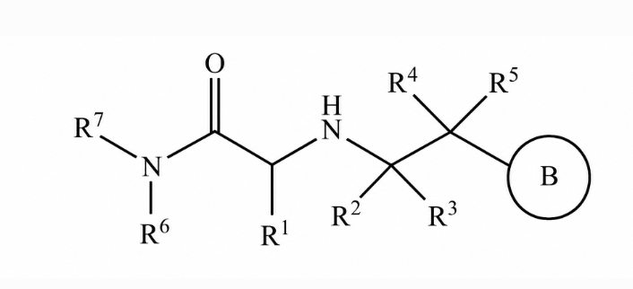

Source section: `二、样例 / （八）简单抽象环 / 示例1`.

Key point: use `<c>9:B</c>` for a simple abstract ring placeholder.

### Figure 13: Abstract Ring with Substituents

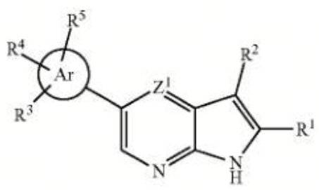

Source section: `二、样例 / （八）简单抽象环 / 示例2`.

Key point: target an abstract ring from `<r>` using `<r><c>10:R[3]</r>`.

### Figure 14: Abstract Ring with Atom and Ring Substituent

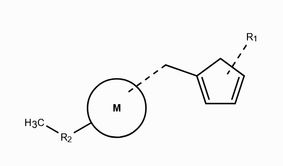

Source section: `二、样例 / （八）简单抽象环 / 示例3`.

Key point: a concrete ring and an abstract ring may coexist; use the correct target for each group.

### Figure 15: Complex Repeat Source

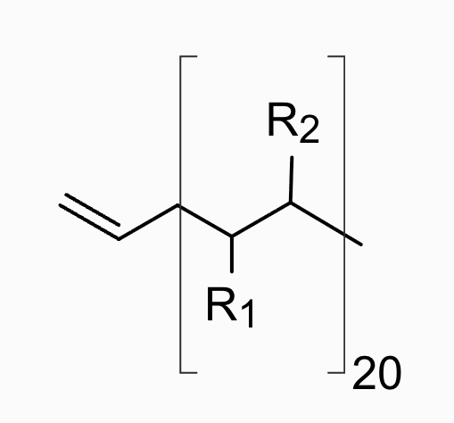

Source section: `二、样例 / （九）复杂重复结构`.

Key point: the repeated fragment must be described by ports and a repeat count.

### Figure 16: Complex Repeat Simplified Base

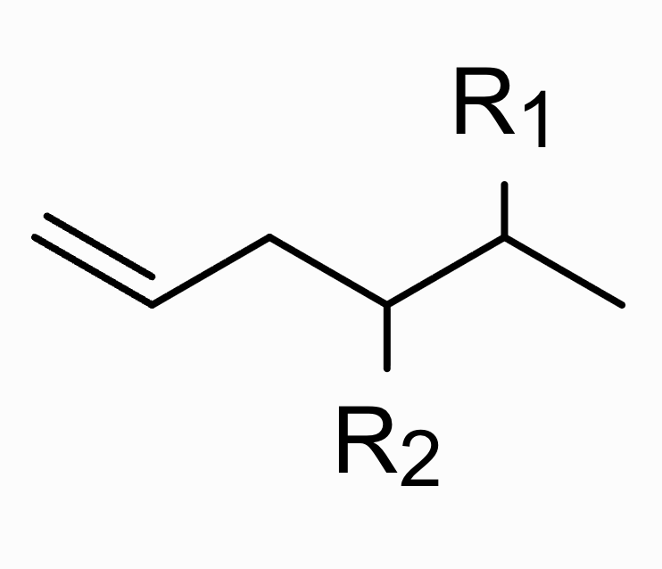

Source section: `二、样例 / （九）复杂重复结构`.

Key point: encode the base molecule first, ignoring the repeat bracket, then add `<g>`.

### Figure 17: Virtual Arc Source

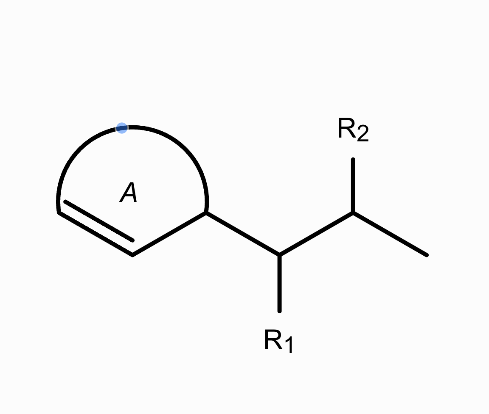

Source section: `二、样例 / （十）特殊抽象环 / 示例1`.

Key point: ignore the virtual arc in the base graph before adding `<v>`.

### Figure 18: Virtual Arc Base

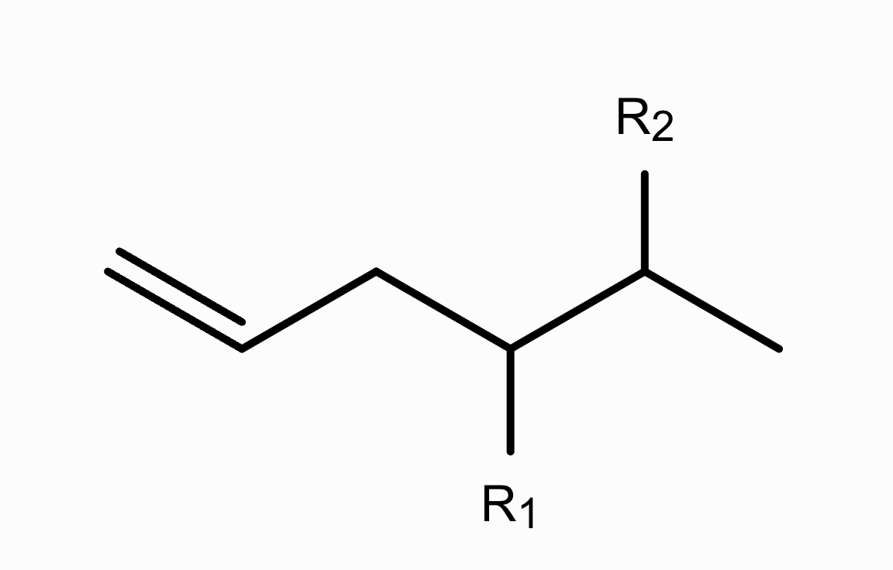

Source section: `二、样例 / （十）特殊抽象环 / 示例1`.

Key point: this is the base structure used before adding virtual arc metadata.

### Figure 19: Virtual Arc with Substituent

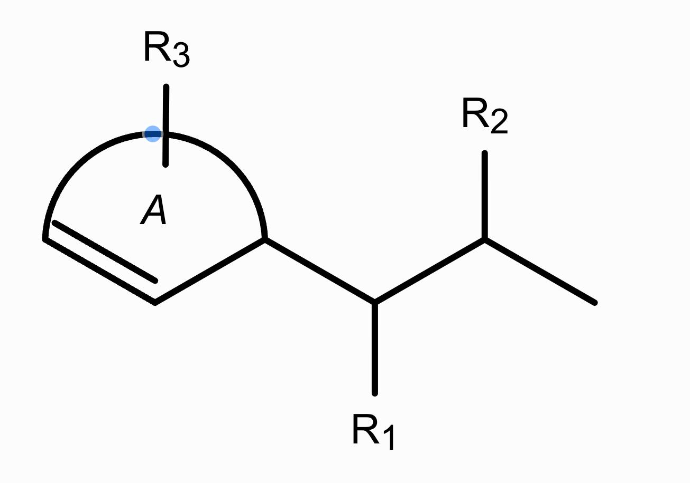

Source section: `二、样例 / （十）特殊抽象环 / 示例2`.

Key point: use `<r><v>0:R[3]</r>` for a substituent attached to the virtual arc.

## Unsupported Examples

### Figure 20: Unsupported Coordination Bond Example 1

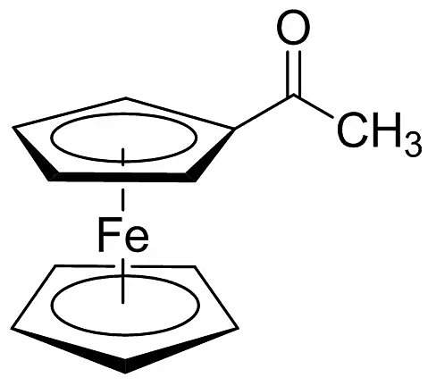

Source section: `三、当前暂不支持表示的情况 / （一）配位键`.

Key point: do not encode this as Extended-SMILES 2.0 without an external metadata policy.

### Figure 21: Unsupported Coordination Bond Example 2

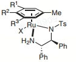

Source section: `三、当前暂不支持表示的情况 / （一）配位键`.

Key point: coordination-bond notation is currently outside the supported rule set.

### Figure 22: Unsupported Coordination Bond Example 3

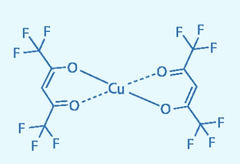

Source section: `三、当前暂不支持表示的情况 / （一）配位键`.

Key point: preserve as unsupported rather than inventing a token.

### Figure 23: Unsupported Electron-Transfer Diagram Example 1

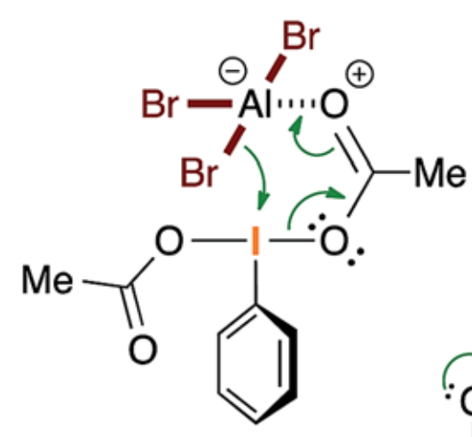

Source section: `三、当前暂不支持表示的情况 / （二）电子转移示意图`.

Key point: electron-transfer arrows are not part of the current E-SMILES format.

### Figure 24: Unsupported Electron-Transfer Diagram Example 2

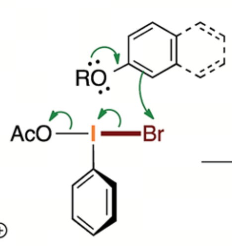

Source section: `三、当前暂不支持表示的情况 / （二）电子转移示意图`.

Key point: record as unsupported or external metadata.

### Figure 25: Unsupported Uncertain Structure Example 1

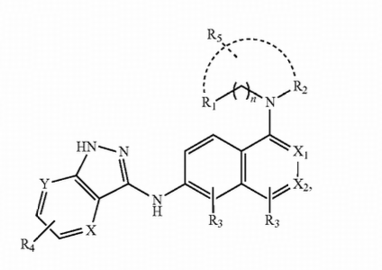

Source section: `三、当前暂不支持表示的情况 / （三）不确定结构`.

Key point: dashed uncertain structure notation is not currently representable in E-SMILES.

### Figure 26: Unsupported Uncertain Structure Example 2

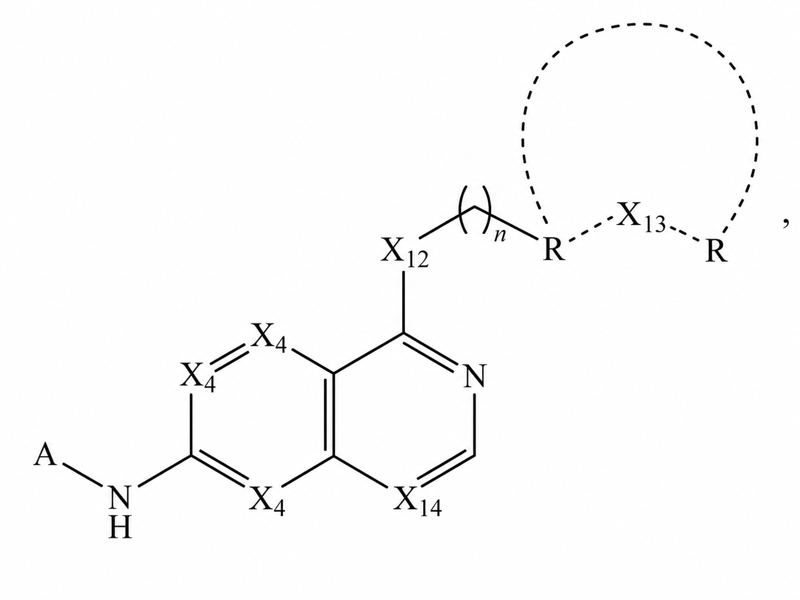

Source section: `三、当前暂不支持表示的情况 / （三）不确定结构`.

Key point: uncertain and wavy bonds remain unsupported.

### Figure 27: Unsupported Uncertain Chirality

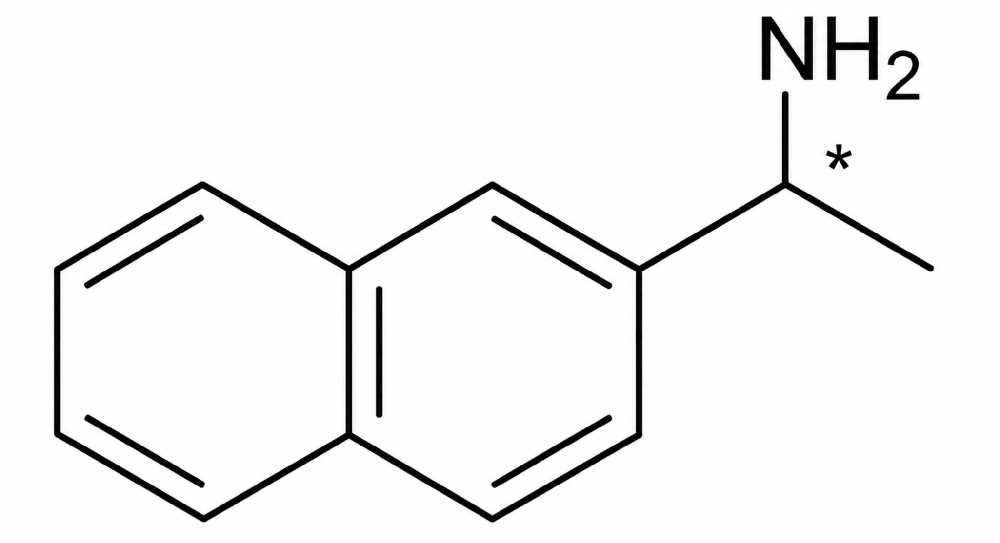

Source section: `三、当前暂不支持表示的情况 / （四）手性不确定`.

Key point: uncertain chirality is listed as unsupported by the source document.

