**MolParser: Extended-SMILES 2.0格式定义**

<table>
<colgroup>
<col style="width: 100%" />
</colgroup>
<tbody>
<tr>
<td style="text-align: left;">
Extended-SMILES 通过“标准 SMILES +
结构化扩展”的框架，在保持与 RDKit 兼容的同时，实现了对复杂 Markush
分子结构的统一化、可解析且对大语言模型（LLM）友好的表达。在实验评估及实际应用中，MolParser
均表现出优异的性能。

然而，在从非结构化科学文献中提取结构化分子信息的过程中，我们观察到仍有少量分子无法被
MolParser
成功识别。这一问题部分源于模型本身的性能限制，但更主要的原因在于当前
E-SMILES 表示能力的不足，尚无法覆盖所有复杂分子结构的表达需求。

因此，本文进一步提出 Extended-SMILES
2.0，在原有框架的基础上扩展其表示能力，以支持更广泛和更复杂的分子结构表达。
</td>
</tr>
</tbody>
</table>

**一、格式定义**

扩展的SMILES（Extended-SMILES）格式定义为：

**SMILES\<sep\>EXTENSION**

其中SMILES为rdkit兼容的SMILES表达方式，每个分子具有唯一表示，可通过如下方法获得
（对于非Markush分子），(rootedAtAtom=0 表示从原子索引为 0 的原子开始生成
SMILES)

<table>
<colgroup>
<col style="width: 100%" />
</colgroup>
<tbody>
<tr>
<td style="text-align: left;">Plain Text 
Chem.MolToSmiles(mol, rootedAtAtom=0, canonical=False,
isomericSmiles=True)</td>
</tr>
</tbody>
</table>

\<sep\>
为分隔符，分隔符前为兼容rdkit的SMILES字符串，分隔符后内容为对这个SMILES的补充描述（如markush基团、连接点、重复基团等）

EXTENSION为可选内容，是对前述SMILES的补充描述，包含若干xml格式撰写的基团，类型包括有6类特殊token包围的group：

\<a\>\[ATOM_INDEX\]:\[GROUP_NAME\]\</a\> 表示取代基。

GROUP_NAME
表示取代基的名称，可以为基团简写、一般取代基、markush基团等，如R，X，Y，Z，Ph，Me，OMe，CF3等，如果为markush取代基且有上下标，可以使用中括号表示上下标内容，如:
R\[1\]，R\[3\]等。

\<d\>\[ATOM_INDEX\]:\[ATTACH_POINT_LABEL\]\</d\>表示连接点。

ATTACH_POINT_LABEL的分类标注详见下文。

\<r\>\[RING_INDEX\]:\[GROUP_NAME\]\</r\> 表示环上任意位置连接基团。

RING_INDEX单独计数。

\<c\>\[ATOM_INDEX\]:\[CIRCLE_NAME\]\</c\> 表示简单抽象环。

\<g\>\[INNER_PORT:OUTER_PORT\]:\|Sg:\[n\]\|\</g\>表示重复结构。

INNER_PORT表示重复结构内的原子，OUTER_PORT表示重复结构外的原子，存在多个端口时可以使用\[INNER_PORT:OUTER_PORT\]重复表示，中间用":"间隔。

\<v\>\[VIRTUALARC_INDEX\]:\[VIRTUALARC_NAME\]:\[FROM_ATOM:TO_ATOM\]\</v\>
表示特殊抽象。

VIRTUALARC_INDEX单独计数。

FROM_ATOM和TO_ATOM分别表示连接成环的两个端点（无方向，位置可互换）。

**二、样例**

**（一）普通分子**

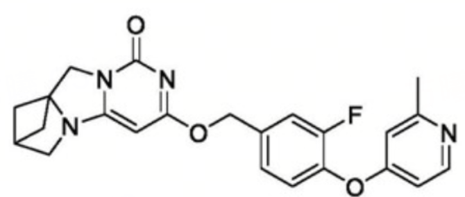

<table>
<colgroup>
<col style="width: 100%" />
</colgroup>
<tbody>
<tr>
<td style="text-align: left;">XML 
Cc1cc(Oc2ccc(COc3cc4n(c(=O)n3)CC35CC(CN43)C5)cc2F)ccn1&lt;sep&gt;</td>
</tr>
</tbody>
</table>

\#
普通分子的extended-SMILES表示，就是用rdkit在rootedAtAtom=0时导出SMILES，并后面加上\<sep\>分隔符

**（二）Markush分子**

markush分子中的取代基使用特殊token \<a\>\</a\>描述。

<table>
<colgroup>
<col style="width: 100%" />
</colgroup>
<tbody>
<tr>
<td style="text-align: left;">XML 
*c1ccccc1&lt;sep&gt; 
&lt;a&gt;0:R[1]&lt;/a&gt;</td>
</tr>
</tbody>
</table>

\#
\<sep\>之后包含若干个被xml\<a\>\</a\>样式包裹的group，比如\<a\>0:R\[1\]\</a\>，\<a\>和\</a\>之间表示取代基，0:表示取代基所在的原子位置（从0开始计数），R表示markush取代基名，\[1\]表示取代基上/下标序号为1

**（三）连接点**

连接位点使用特殊token \<d\>\</d\>描述。

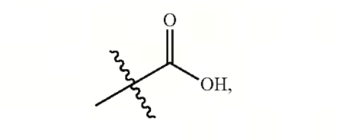

<table>
<colgroup>
<col style="width: 100%" />
</colgroup>
<tbody>
<tr>
<td style="text-align: left;">XML 
*C(O)=O&lt;sep&gt; 
&lt;d&gt;0:&lt;dum&gt;&lt;/d&gt;</td>
</tr>
</tbody>
</table>

\#\<d\>0:\<dum\>\</d\>表示连接点

虚线连接点

**（四）特殊Markush基团**

特殊Markush的标注使用特殊token \<id\>\[备注\]
表示。备注中可以预先在画板中预设若干常见的标签，例如\<red\>/\<blue\>这类描述颜色的标签或
\<ball\>/\<rectangle\>/\<RNA\>/\<DNA\>/\<protein\>这类描述成分的标签。

灵活输入：可以根据不同标注任务的要求，在备注里输入不同的自定义标签。

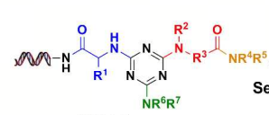

<table>
<colgroup>
<col style="width: 100%" />
</colgroup>
<tbody>
<tr>
<td style="text-align: left;">XML 
N(*)(*)C1=NC(NC(*)C(=O)N*)=NC(N(*)***C(=O)N(***)*)=N1&lt;sep&gt; 
&lt;a&gt;1:R[6]&lt;/a&gt; 
&lt;a&gt;2:R[7]&lt;/a&gt; 
&lt;a&gt;8:R[1]&lt;/a&gt; 
&lt;a&gt;12:&lt;id&gt;[DNA]&lt;/a&gt; 
&lt;a&gt;16:R[2]&lt;/a&gt; 
&lt;a&gt;17:R[3]&lt;/a&gt; 
&lt;a&gt;21:R[5]&lt;/a&gt; 
&lt;a&gt;22:R[4]&lt;/a&gt;</td>
</tr>
</tbody>
</table>

\# \<a\>12:\<id\>\[0\]\</a\>,
其中\<a\>12表示第12号位置，\<id\>\[RNA\]表示该特殊基团为一段DNA结构

**（五）环上连接集团**

环上连接基团在表示时，使用特殊token
\<r\>\</r\>表示，同时<u>使用环id进行编码而非原子id</u>。

**示例1：环上连接基团数量=1**

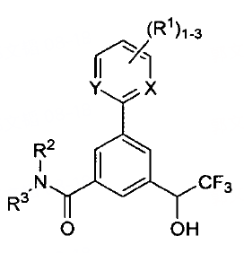

<table>
<colgroup>
<col style="width: 100%" />
</colgroup>
<tbody>
<tr>
<td style="text-align: left;">XML 
*C(O)c1cc(C(=O)N(*)*)cc(-c2*ccc*2)c1&lt;sep&gt; 
&lt;a&gt;0:CF3&lt;/a&gt; 
&lt;a&gt;9:R[3]&lt;/a&gt; 
&lt;a&gt;10:R[2]&lt;/a&gt; 
&lt;a&gt;14:X&lt;/a&gt; 
&lt;a&gt;18:Y&lt;/a&gt; 
&lt;r&gt;1:R[1]?1-3&lt;/r&gt;</td>
</tr>
</tbody>
</table>

\# \<r\>1:R\[1\]?1-3\</r\>,
其中\<r\>1表示第1个环（右下角c为起始点，下面一个环是第0个环，上面一个环为第1个环）。R\[1\]表示取代基名称，?1-3表示重复（具体规则可参考下文）。

**示例2：环上连接基团数量=2**

<table>
<colgroup>
<col style="width: 100%" />
</colgroup>
<tbody>
<tr>
<td style="text-align: left;">XML 
c1ccccc1&lt;sep&gt; 
&lt;r&gt;0:R[1]&lt;/r&gt; 
&lt;r&gt;0:R[2]&lt;/r&gt;</td>
</tr>
</tbody>
</table>

\# \<r\>0:R\[1\]\</r\>, 其中\<r\>0表示第0个环，环上取代基是R\[1\]。

\# \<r\>0:R\[2\]\</r\>, 其中\<r\>0表示第0个环，环上取代基是R\[2\]。

**示例3：环上连接基团数量≥2，且存在非单一atom/简单基团**

环上有非单一atom/简单基团，如果相对较为简单，也可以使用子结构来表示，也可以使用简写表示，其中简写表示更为简单合理。两种表示方法均合法。

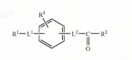

子结构表示法：

<table>
<colgroup>
<col style="width: 100%" />
</colgroup>
<tbody>
<tr>
<td style="text-align: left;">XML 
c1ccccc1&lt;sep&gt; 
&lt;r&gt;0:R[3]&lt;/r&gt; 
&lt;r&gt;0:&lt;s&gt;**&lt;sep&gt;&lt;a&gt;0:L[1]&lt;/a&gt;&lt;a&gt;1:R[1]&lt;/a&gt;&lt;/s&gt;&lt;/r&gt; 
&lt;r&gt;0:&lt;s&gt;*C(*)=O&lt;sep&gt;&lt;a&gt;0:L[2]&lt;/a&gt;&lt;a&gt;2:R[2]&lt;/a&gt;&lt;/s&gt;&lt;/r&gt;</td>
</tr>
</tbody>
</table>

简写表示法：

<table>
<colgroup>
<col style="width: 100%" />
</colgroup>
<tbody>
<tr>
<td style="text-align: left;">XML 
c1ccccc1&lt;sep&gt; 
&lt;r&gt;0:L[1]R[1]&lt;/r&gt; 
&lt;r&gt;0:L[2]COR[2]&lt;/r&gt; 
&lt;r&gt;0:R[3]&lt;/r&gt;</td>
</tr>
</tbody>
</table>

\# 视为三个取代基：L\[1\]R\[1\] 、L\[2\]COR\[2\]、R\[3\]

**（六）重复基团**

重复基团的表示使用"?n"表示，其中?代表重复的特殊标识符，n表示重复次数，可根据分子图中的确切表示替换为数字，或其它抽象字母。当重复次数是一个范围时，使用"?m-n"表示。

**示例1：重复n次**

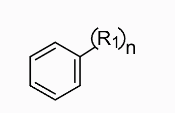

<table>
<colgroup>
<col style="width: 100%" />
</colgroup>
<tbody>
<tr>
<td style="text-align: left;">XML 
c1ccccc1*&lt;sep&gt; 
&lt;a&gt;7:R[1]?n&lt;/a&gt;</td>
</tr>
</tbody>
</table>

\#
\<a\>7:R\[1\]?n\</a\>中，在取代基名称R\[1\]后出现的?n表示复制该基团n次

**示例2：重复m-n次**

<table>
<colgroup>
<col style="width: 100%" />
</colgroup>
<tbody>
<tr>
<td style="text-align: left;">XML 
*C(O)c1cc(C(=O)N(*)*)cc(-c2*ccc*2)c1&lt;sep&gt; 
&lt;a&gt;0:CF3&lt;/a&gt; 
&lt;a&gt;9:R[3]&lt;/a&gt; 
&lt;a&gt;10:R[2]&lt;/a&gt; 
&lt;a&gt;14:X&lt;/a&gt; 
&lt;a&gt;18:Y&lt;/a&gt; 
&lt;r&gt;1:R[1]?1-3&lt;/r&gt;</td>
</tr>
</tbody>
</table>

\# \<r\>1:R\[1\]?1-3\</r\>中，在取代基名称R\[1\]后出现的?1-3表示复制基团

\# ?1-3表示重复组件复制1-3份

**示例3：重复子结构**

对于重复子结构，如果相对比较简单，也可以使用简写来表示，也可用复杂重复结构表示法。

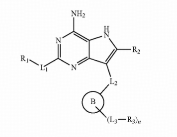

子结构表示：

<table>
<colgroup>
<col style="width: 100%" />
</colgroup>
<tbody>
<tr>
<td style="text-align: left;">XML 
N1=C(N)C2=C(C(=C(N2)*)***)N=C1**&lt;sep&gt; 
&lt;a&gt;8:R[2]&lt;/a&gt;&lt;a&gt;9:L[2]&lt;/a&gt;&lt;a&gt;10:B&lt;/a&gt; 
&lt;s&gt;**&lt;sep&gt;&lt;a&gt;0:L[3]&lt;/a&gt;&lt;a&gt;1:R[3]&lt;/a&gt;|Sg:n|&lt;/s&gt; 
&lt;a&gt;14:L[1]&lt;/a&gt;&lt;a&gt;15:R[1]&lt;/a&gt;</td>
</tr>
</tbody>
</table>

简写表示：

<table>
<colgroup>
<col style="width: 100%" />
</colgroup>
<tbody>
<tr>
<td style="text-align: left;">XML 
N1=C(N)C2=C(C(=C(N2)*)***)N=C1**&lt;sep&gt; 
&lt;a&gt;8:R[2]&lt;/a&gt;&lt;a&gt;9:L[2]&lt;/a&gt;&lt;a&gt;10:B&lt;/a&gt;&lt;a&gt;11:L[3]R[3]?n&lt;/a&gt;&lt;a&gt;14:L[1]&lt;/a&gt;&lt;a&gt;15:R[1]&lt;/a&gt;</td>
</tr>
</tbody>
</table>

复杂结构表示法：

该类分子请参考【（九）复杂重复结构】的标注

**（七）高分子/聚合物**

高分子/聚合物使用 \|Sg:n\|
来表示重复。与上文中（六）重复基团的区别在于，高分子/聚合物是整体结构的重复。其完整重复结构的表示可简单分为2步：

参考（三）连接点的标注方法，标注基本的重复单元。此时需要注意，其两端并非原子，而是连接点。

使用\|Sg:n\|表示这是一个完整的重复结构。其中n指代重复次数，当无明确指出时，可用n抽象表示。当有明确指出时，可替换为具体的数字、字母或范围（例如m-n）。

**回滚回用\*给端基占位**

**示例1：完整重复结构**

>  src="../assets/images/10-polymer-original.png"
> style="width:2.8125in;height:1.27083in" />

第一步，忽略重复，标注基本单元：

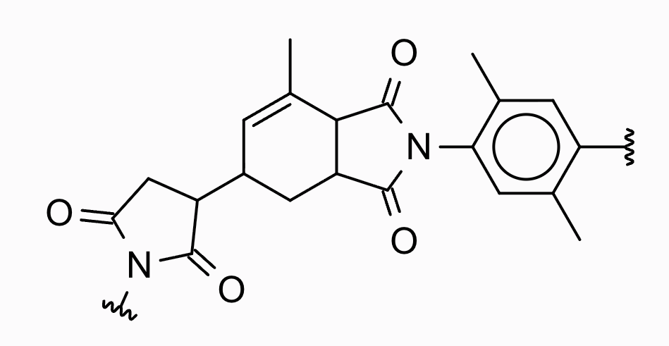

注意：连接点占用了一个原子位点，在esmiles中使用 '\*' 表示。

<table>
<colgroup>
<col style="width: 100%" />
</colgroup>
<tbody>
<tr>
<td style="text-align: left;">XML 
c1(*)c(C)cc(N2C(=O)C3C(C(C)=CC(C4C(=O)N(*)C(=O)C4)C3)C2=O)c(C)c1&lt;sep&gt; 
&lt;d&gt;1:&lt;dum&gt;&lt;/d&gt; 
&lt;d&gt;19:&lt;dum&gt;&lt;/d&gt;</td>
</tr>
</tbody>
</table>

第二步，使用\|Sg:n\|表示重复结构。即：

<table>
<colgroup>
<col style="width: 100%" />
</colgroup>
<tbody>
<tr>
<td style="text-align: left;">XML 
c1(*)c(C)cc(N2C(=O)C3C(C(C)=CC(C4C(=O)N(*)C(=O)C4)C3)C2=O)c(C)c1&lt;sep&gt; 
&lt;d&gt;1:&lt;dum&gt;&lt;/d&gt; 
&lt;d&gt;19:&lt;dum&gt;&lt;/d&gt; 
|Sg:n|</td>
</tr>
</tbody>
</table>

**（八）简单抽象环**

简单的抽象环可以被当成一类特殊的R基团进行标注，但与R基团不同的是，抽象环需要用特殊token
\</c\>\<c\>来表示。

当抽象环上存在连接基团时，

**示例1：普通抽象环**

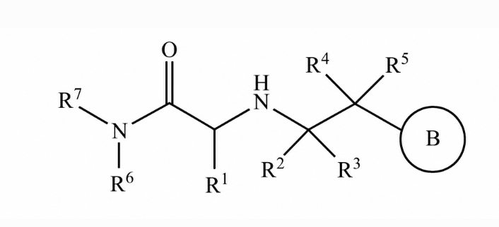

<table>
<colgroup>
<col style="width: 100%" />
</colgroup>
<tbody>
<tr>
<td style="text-align: left;">XML 
*C(NC(*)(*)C(*)(*)*)C(=O)N(*)*&lt;sep&gt; 
&lt;a&gt;0:R[1]&lt;/a&gt; 
&lt;a&gt;4:R[3]&lt;/a&gt; 
&lt;a&gt;5:R[2]&lt;/a&gt; 
&lt;a&gt;7:R[5]&lt;/a&gt; 
&lt;a&gt;8:R[4]&lt;/a&gt; 
&lt;c&gt;9:B&lt;/c&gt; 
&lt;a&gt;13:R[7]&lt;/a&gt; 
&lt;a&gt;14:R[6]&lt;/a&gt;</td>
</tr>
</tbody>
</table>

\# 此处特殊token \<c\> 表示抽象环，其原子序号是9，名称是B

**示例2：抽象环上有连接基团**

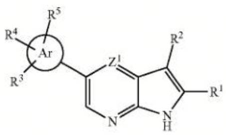

<table>
<colgroup>
<col style="width: 100%" />
</colgroup>
<tbody>
<tr>
<td style="text-align: left;">XML 
*C1=C(*)C2C(=NC=C(*=2)*)N1<em>&lt;sep&gt;</em> 
&lt;a&gt;0:R[1]&lt;/a&gt; 
&lt;a&gt;3:R[2]&lt;/a&gt; 
&lt;a&gt;9:Z[1]&lt;/a&gt; 
&lt;c&gt;10:Ar&lt;/c&gt; 
&lt;r&gt;&lt;c&gt;10:R[3]&lt;/r&gt; 
&lt;r&gt;&lt;c&gt;10:R[4]&lt;/r&gt; 
&lt;r&gt;&lt;c&gt;10:R[5]&lt;/r&gt;</td>
</tr>
</tbody>
</table>

\# 特殊token \<c\> 表示抽象环，其原子序号是10，名称是Ar。

\# \<r\>\<c\>10:R\[3\]\</r\>
表示在原子序号为10的抽象环"\<c\>10"上连接取代基R3

**示例3：抽象环上有连接基团+原子**

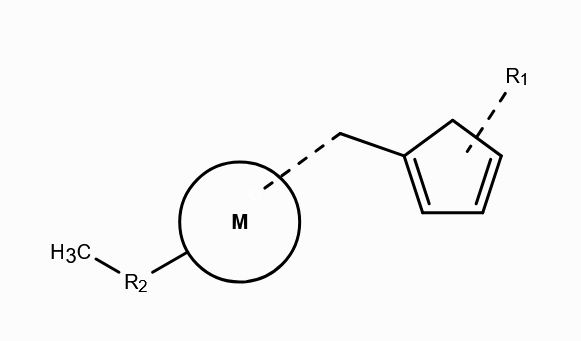

<table>
<colgroup>
<col style="width: 100%" />
</colgroup>
<tbody>
<tr>
<td style="text-align: left;">XML 
C**CC1=CC=CC1&lt;sep&gt; 
&lt;a&gt;1:R[2[&lt;/a&gt; 
&lt;c&gt;2:M&lt;/c&gt; 
&lt;r&gt;0:R[1]&lt;/r&gt;</td>
</tr>
</tbody>
</table>

\# 特殊token \<c\> 表示抽象环，其原子序号是2，名称是M。

\# R1连接在五元环上，按照环上取代基规则，该环id=0。

**（九）复杂重复结构**

复杂重复结构的表示可以简单分为2步:

第1步忽略重复的括号和数字，使用E-SMILES表示一个完整的分子或结果；

第2步使用\<g\>\</g\>描述一个的重复片段（group），其中\[INNER_PORT:OUTER_PORT\]和\|Sg:n\|描述端口连接情况和重复次数。

**例如**：现在有一个存在重复片段的复杂markush

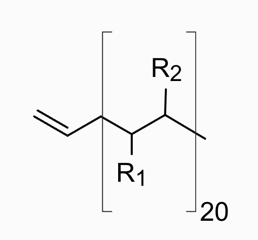

第1步，忽略重复的括号和数字，使用E-SMILES表示简单markush，即：

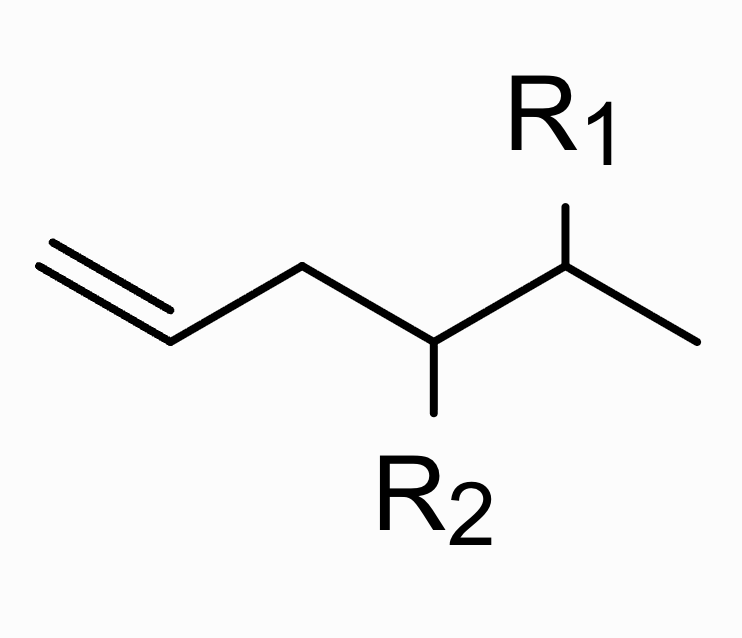

<table>
<colgroup>
<col style="width: 100%" />
</colgroup>
<tbody>
<tr>
<td style="text-align: left;">XML 
C=CCC(C(C)*)*&lt;sep&gt; 
&lt;a&gt;6:R[2]&lt;/a&gt; 
&lt;a&gt;7:R[1]&lt;/a&gt;</td>
</tr>
</tbody>
</table>

第2步，在此基础上，描述重复的片段：

已知，重复的片段仅有一个。因此用一个\<g\>\</g\>描述。

<table>
<colgroup>
<col style="width: 100%" />
</colgroup>
<tbody>
<tr>
<td style="text-align: left;">XML 
C=CCC(C(C)*)*&lt;sep&gt; 
&lt;a&gt;6:R[2]&lt;/a&gt; 
&lt;a&gt;7:R[1]&lt;/a&gt; 
&lt;g&gt;[3:2]:[4:5]:|Sg:20|&lt;/g&gt;</td>
</tr>
</tbody>
</table>

\#使用特殊token\<g\>\</g\>表示重复片段。\[3:2\]表示id=3的<u>内部</u>原子和id=2的<u>外部</u>原子相连，
\[4:5\]表示id=4的<u>内部</u>原子和id=5的<u>外部</u>原子相连，
\|Sg:20\|表示重复20次。

【为什么R1和R2也重复，但是并未在上述E-SMILES中表示？因为我们只保存连接端口，通过计算可以得出在端口之间的其它重复原子。这个计算可以在MolParserUtils中实现。】

**（十）特殊抽象环**

特殊抽象环使用特殊token\<v\>\</v\>来进行描述，带有特殊抽象环的分子表示可以分为2步：

第1步忽略特殊抽象环，使用E-SMILES表示一个完整的分子或结果；

第2步使用\<v\>\</v\>描述一个抽象环(virtualArc)，并在其中使用特殊抽象环序号进行标记。同时记录该抽象环的name和端口。

**示例1：简单特殊抽象环**

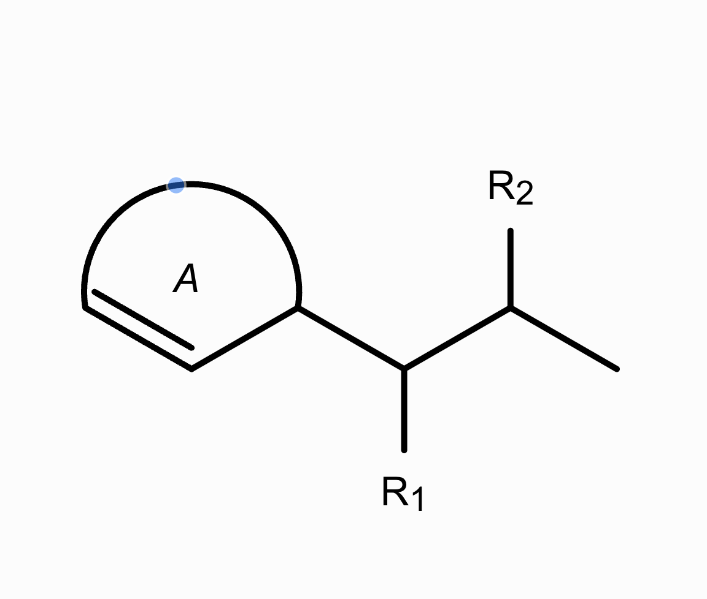

第1步，忽略抽象环，使用E-SMILES表示简单markush，即：

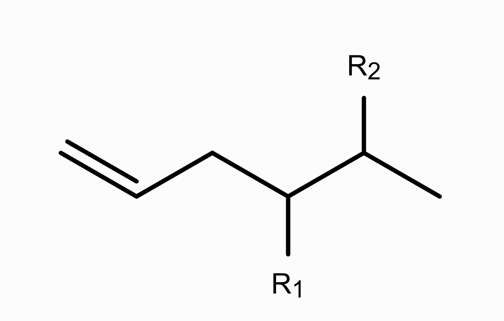

<table>
<colgroup>
<col style="width: 100%" />
</colgroup>
<tbody>
<tr>
<td style="text-align: left;">XML 
C=CCC(C(C)*)*&lt;sep&gt; 
&lt;a&gt;6:R[2]&lt;/a&gt; 
&lt;a&gt;7:R[1]&lt;/a&gt;</td>
</tr>
</tbody>
</table>

第2步，在此基础上，描述抽象环的成环信息：

<table>
<colgroup>
<col style="width: 100%" />
</colgroup>
<tbody>
<tr>
<td style="text-align: left;">XML 
C=CCC(C(C)*)*&lt;sep&gt; 
&lt;a&gt;6:R[2]&lt;/a&gt; 
&lt;a&gt;7:R[1]&lt;/a&gt; 
&lt;v&gt;0:A:[0:2]&lt;/v&gt;</td>
</tr>
</tbody>
</table>

\#第0个特殊抽象环，name="A"，成环连接的原子序号为0和2。注意\[2:0\]这样表达也是正确的。

**示例2：特殊抽象环上连接基团**

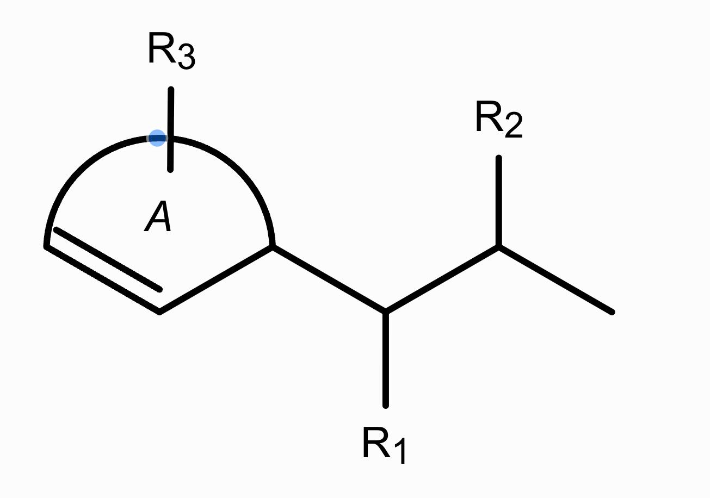

<table>
<colgroup>
<col style="width: 100%" />
</colgroup>
<tbody>
<tr>
<td style="text-align: left;">XML 
C=CCC(C(C)*)*&lt;sep&gt; 
&lt;a&gt;6:R[2]&lt;/a&gt; 
&lt;a&gt;7:R[1]&lt;/a&gt; 
&lt;v&gt;0:A:[0:2]&lt;/v&gt; 
&lt;r&gt;&lt;v&gt;0:R[3]&lt;/r&gt;</td>
</tr>
</tbody>
</table>

\#环上连接基团使用特殊token
\<r\>\</r\>，因为该环是第0个特殊抽象环，所以应该使用\<v\>0描述。取代基是R\[3\]。

**三、当前暂不支持表示的情况**

（一）配位键

|  |  |  |
|:--:|:--:|:--:|
| 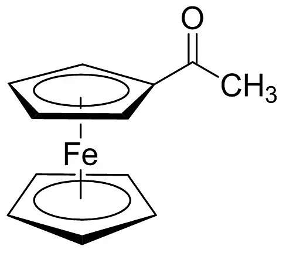 | 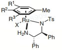 | 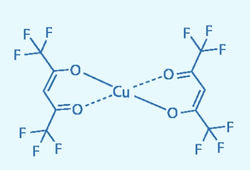 |

（二）电子转移示意图

|  |  |
|:--:|:--:|
| 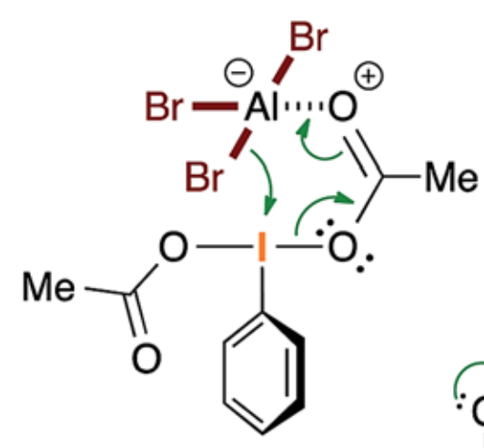 | 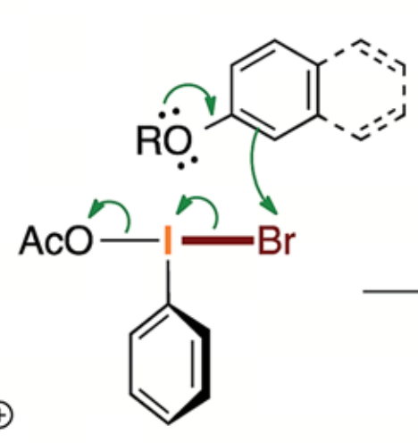 |

（三）不确定结构（虚线表示）

当前画板可以绘制虚线，但是没有合适的符合在ESMILES中表示

|  |  |
|:--:|:--:|
| 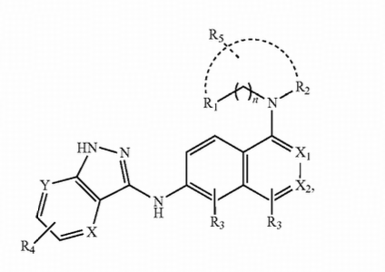 | 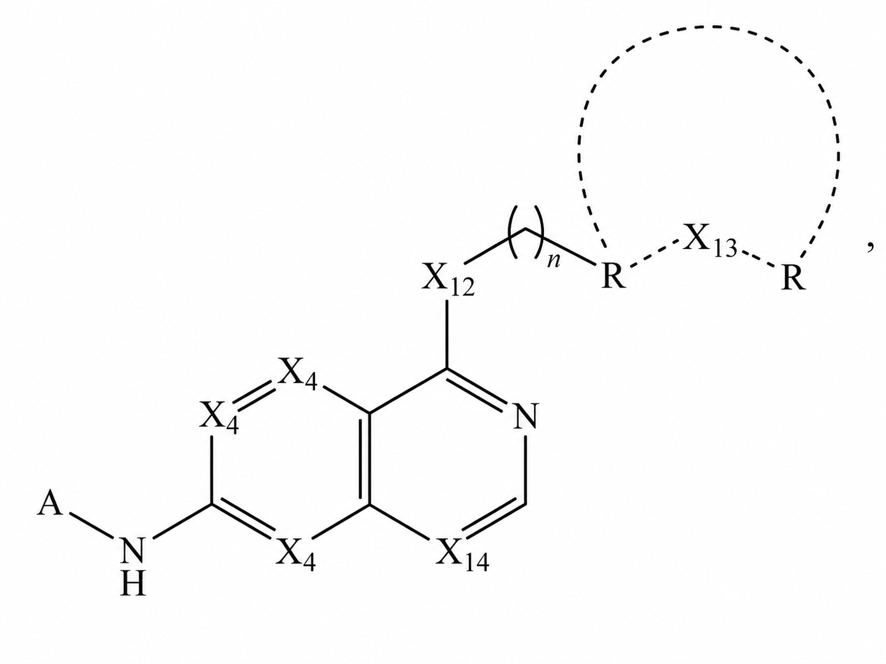 |

同理，不确定键、波浪键等都暂无法使用ESMILES中表示

（四）手性不确定

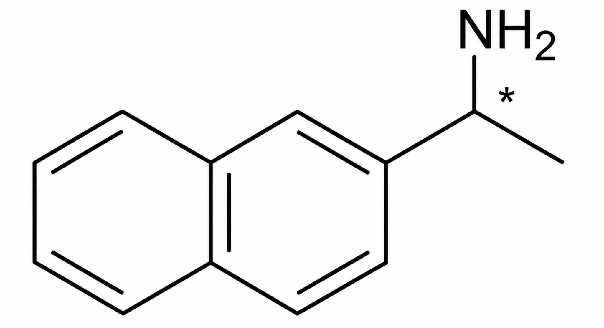
