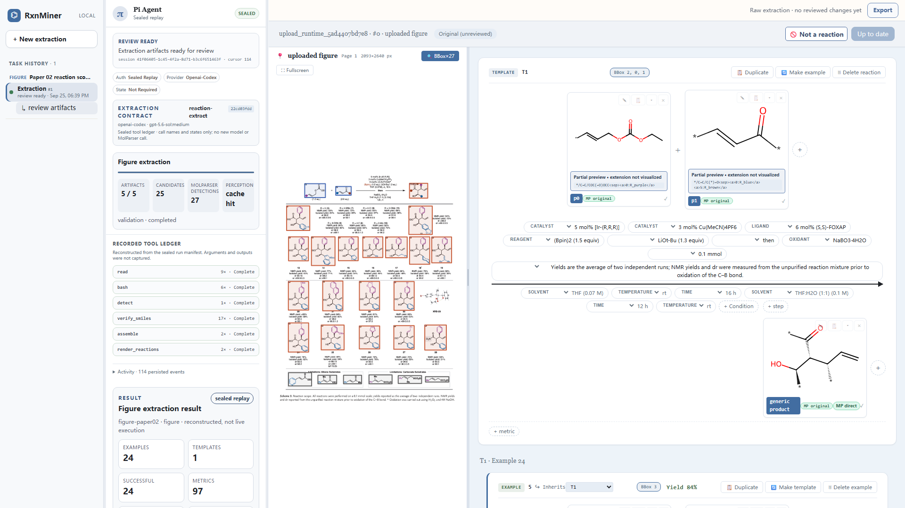

<p align="center"></p>

<h1 align="center">RxnMiner</h1>

<p align="center"><strong>From chemical literature to structured, reviewable reactions.</strong><br>
Reaction figures and schemes. Chemical structures, reaction conditions, and source evidence.</p>

<p align="center"><a href="https://rxnminer.github.io/RxnMiner/">Website</a> · <a href="https://rxnminer.github.io/RxnMiner/demos/">Demo</a> · <a href="https://rxnminer.github.io/RxnMiner/benchmark/">Benchmark</a> · <a href="docs/getting-started.md">Getting started</a></p>

<p align="center"></p>

RxnMiner reads chemistry figures, extracts concrete reactions, and connects the results to their source. A chemistry agent uses structure recognition, R-group assembly, RDKit verification, and visual inspection to produce structured V2 JSON. The local workbench lets you inspect evidence, edit structures with Ketcher, and export reviewed results.

This repository contains the source, English website, visual demo, and benchmark. Licensing and third-party notices are in [LICENSING.md](docs/LICENSING.md).

The website is built as a static Astro site and deployed from `main` by GitHub Actions to
`https://rxnminer.github.io/RxnMiner/` when Pages is enabled for the repository.

## What you can do

| Input | Workflow | Result |
|---|---|---|
| Reaction scheme, scope, or optimization table | Recognize structures, resolve substituents, verify molecules | Concrete reactants and products, stereochemistry, conditions, yields |
| Existing V2 extraction | Inspect the source, edit with Ketcher, review changes | Original output plus a separate reviewed version |

## Start with the local workbench

Use Linux or macOS, or WSL2 on Windows, with **Node.js 22.19+**, **Python 3.11**, Java 8+, Git, and Bash.

```bash
git clone https://github.com/rxnminer/RxnMiner.git
cd RxnMiner
npm ci
node ./rxnminer.mjs setup
node ./rxnminer.mjs demo demo-figure --no-browser
```

Open the `workspaceUrl` printed by the command. This recorded replay needs no model account and makes no recognition calls. It demonstrates the real workbench using attributed demonstration material; it is not a new extraction run.

For live extraction, authenticate your model through `node ./rxnminer.mjs login`, then configure your own UniParser key:

```bash
export UNIPARSER_BASE_URL=https://uniparser.dp.tech/
export UNIPARSER_API_KEY=your-key
node ./rxnminer.mjs extract figure.png --pi-auth
```

Obtain a key from [UniParser](https://uniparser.dp.tech/). The `.env.example` contains **blank keys only**; the commands above read exported environment variables. Recognition and model inference use your own service accounts.

The submission edition uses [UniParser-Tools](https://github.com/dptech-corp/UniParser-Tools) **snip mode** for molecule recognition. It does not require access to the original internal MolParser endpoint. Historical schema field names and cached results remain compatible.

## Benchmark

[ChemRxn-Bench](https://rxnminer.github.io/RxnMiner/benchmark/) contains **603 figures** and **8,510 normalized reference reactions** across five layout categories. The website provides:

- a **603-figure table** with 23 lanes;
- a switchable **LLM Judge** view sourced from the public judge snapshot;
- strict stereochemistry and connectivity-only scores, with downloadable summary and per-figure metrics.

Failures remain in the denominator. These are archived benchmark results from a fixed public snapshot; they are not a rerun of the current recognition integration. See [evaluation methodology](docs/benchmark.md).

## Repository guide

| Directory | Purpose |
|---|---|
| `RxnMiner/` | CLI, chemistry services, visual review, extraction skills, and runtime |
| `website/` | English Home, Demo, and Benchmark pages |
| `docs/` | Setup, evaluation methodology, source notices, and maintenance |
| `scripts/` | Repository and release verification |

The public demo ships figure samples and a sealed figure replay; original PDF and SI source files are not bundled. Internal handoffs, credentials, raw benchmark corpora, and obsolete demos are excluded. Source acknowledgments and vendored compatibility patches are recorded in [THIRD_PARTY_NOTICES.md](docs/THIRD_PARTY_NOTICES.md).

## Develop and verify

```bash
npm test
npm run test:recognition
npm --prefix website ci
npm --prefix website run check
npm --prefix website run build
python3 scripts/audit_release.py
```

Preview the website with `npm --prefix website run dev`. See [website deployment](docs/website.md) for GitHub Pages and local preview. Contributions should include a focused change and validation; see [CONTRIBUTING.md](.github/CONTRIBUTING.md).
