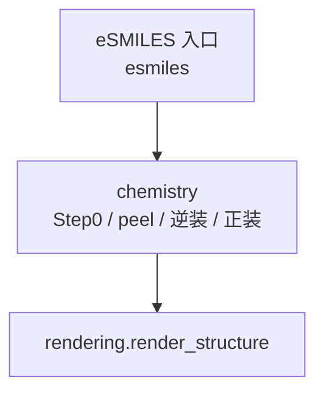

# src — 核心库

`src` 根只放包，不散落业务 `.py`：

```text
src/
  chemistry/   # 正装 / Step0 / peel / 逆装 / 几何 / rendering
  esmiles/     # eSMILES 协议
  translator/  # 缩写表实现（esmiles.abbrev 用）
  README.md
```

批量在 [`batch/`](../batch/)；语料 I/O 在 [`web/synfacts/`](../web/synfacts/)；缩写表编辑在 [`web/abbrev_csv_editor.py`](../web/abbrev_csv_editor.py)。

## 包一览

### `chemistry/` — 算法

| 模块 | 职责 |
|------|------|
| `decompose` | **`step0_scaffold_map`**：逆问题总入口 |
| `reverse_assembly` | **`reverse_assemble`**：peel + 填反应物通式（路线 B **核**；JSON 编排在 `web/synfacts/reverse_examples`） |
| `peel` / `align` / `candidates` | 扣取代基、嵌入、候选 |
| `assembly` | 正装 + 底层 PNG 工具 |
| `models` | `AnchorInfo` / `MatchCandidate` / … |
| `anchors` / `r_groups` | `<a>` / R 标签 |
| `peel_topology` / `scaffold_geom` / `stereo` / `roundtrip` | 校验与几何 |
| `rendering` | **用户可见**统一渲染：`render_structure` |
| `assembly_export` / `chem_util` | peel→片段桥、小工具 |

```python
from chemistry import reverse_assemble, step0_scaffold_map, assemble_fragments, render_structure
```

详见 [`chemistry/README.md`](chemistry/README.md)。

### `esmiles/` — 协议

load / ingress / abbrev / encode / contract。文档 [`esmiles/README.md`](esmiles/README.md)。

```python
from esmiles import normalize_fragment_esmiles, load_esmiles, …
```

### `translator/`

缩写 CSV 与 Translator（由 `esmiles.abbrev` 调用）。

## 核心信息流



Viewer 应编排：读 JSON → `esmiles` / `chemistry.reverse_assemble` / `render_structure`。

---

## 重构状态

**成功标准：** `src/` 根无散落业务 `.py`（仅包 + README）。已达成。

| 优先级 | 做什么 |
|--------|--------|
| **P0** | 收紧 Step0 / 逆装 / 正装 / eSMILES / `rendering` |
| **P1** | ~~批量~~、~~synfacts~~、~~chemistry 包~~、~~逆装 Synfacts 编排外迁~~；扩 `rendering`；再瘦出图/比对 |
| **P2** | 几何捆包、高亮 `kind="highlight"`；PNG 从 `assembly` 剥到 `rendering` |

### `reverse_assembly` 瘦身进度

- **已做：** Synfacts JSON 编排 → [`web/synfacts/reverse_examples.py`](../web/synfacts/reverse_examples.py)（~500 行）；核 ~980 行。  
- **仍欠：** 出图/`attach_expected_comparisons` 旁路、`assembly` 底层 PNG → 见 [`chemistry/README.md`](chemistry/README.md)「诚实债务」。
